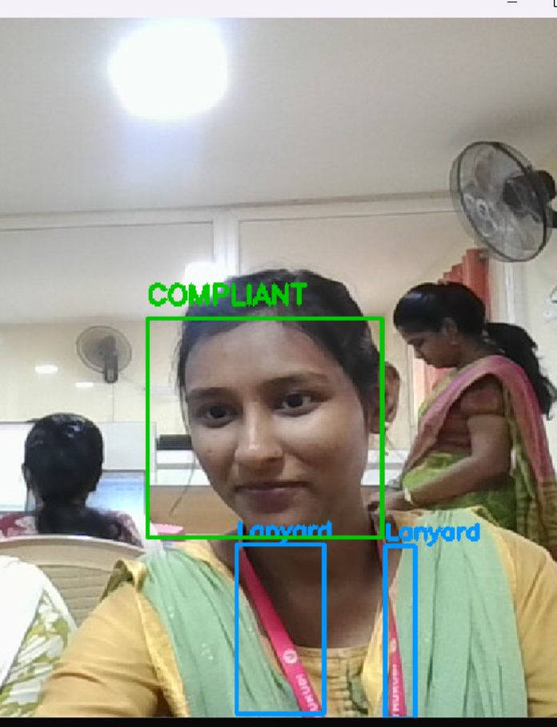
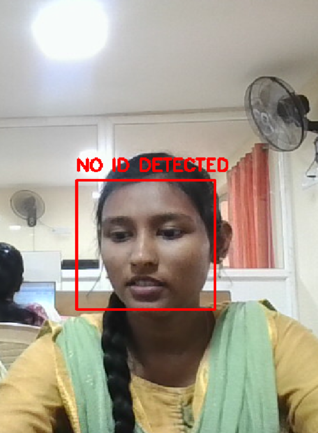

# Student ID Compliance Detection System

Real-time ID card compliance monitoring using computer vision. A webcam feed is analysed to check whether each student is wearing an ID card. Violations are captured as evidence and reported automatically to staff.

## Features

- Detects faces in a live webcam feed and checks for an ID card in the neck/chest region
- Green box for compliant students, red box for non-compliant students
- Confirms a violation only after 2 seconds of non-compliance, to avoid false alarms
- Saves a timestamped screenshot and a CSV log entry for every confirmed violation
- Optional student identification using face recognition
- Emails a grouped, per-student PDF report to a staff member when a session ends
  
## Screenshots



## Tech Stack

Python, OpenCV, YOLOv8 (Ultralytics), Roboflow, dlib / face_recognition, ReportLab

## How It Works

1. Capture a frame from the webcam.
2. Detect faces using an OpenCV Haar Cascade.
3. Crop the neck/chest region below each face and run a custom-trained YOLOv8 model on it to look for an ID card.
4. Draw a green or red box and track how long a student has been non-compliant.
5. After 2 seconds of non-compliance, identify the student, save evidence and log it.
6. On quit, compile the session's violations into a PDF and email it.

## Setup

```bash
pip install -r requirements.txt
```

1. Put one clear front-facing photo per student in a `known_faces/` folder, named after the student (for example `Priya_Sharma.jpg`), if you want name identification. Then set `USE_FACE_RECOGNITION = True` in `main.py`.
2. Open `send_daily_report.py` and fill in your sender Gmail, a Gmail App Password and the teacher's email.
3. Run:

```bash
python main.py
```

Press `q` to quit and send the report.

## Training Your Own Model

The training images are not included, since they contain people. To retrain:

1. Collect and label images in Roboflow (class: ID card, with no-ID images marked as Null).
2. Export in YOLOv8 format into a `dataset/` folder.
3. Run `python train_model.py`.
4. Copy the best weights to `id_lanyard_best.pt`.

## Results

| Run | Images | mAP50 | Precision |
|---|---|---|---|
| 1 | 109 | 29% | n/a |
| 2 | 181 | 39.5% | 60% |
| 3 | 435 (augmented) | 36.3% | 59% |
| 4 | 435 (augmented) | 35.2% | 65.3% |
| 5 | 308 | 35.6% | 49.5% |

Adding targeted training images raised accuracy the most. Remaining errors come from limited data.

## Known Limitations

- Accuracy drops when the card colour matches the clothing.
- Busy patterns, necklaces and collars can occasionally be mistaken for a card.
- Trained on a small, self-collected dataset and run on CPU only.

## Privacy

This repository contains no student photos, names or violation records. Anyone deploying it must follow their institution's data-protection rules for storing facial images.

## Author

Christina Angel J, II MCA
